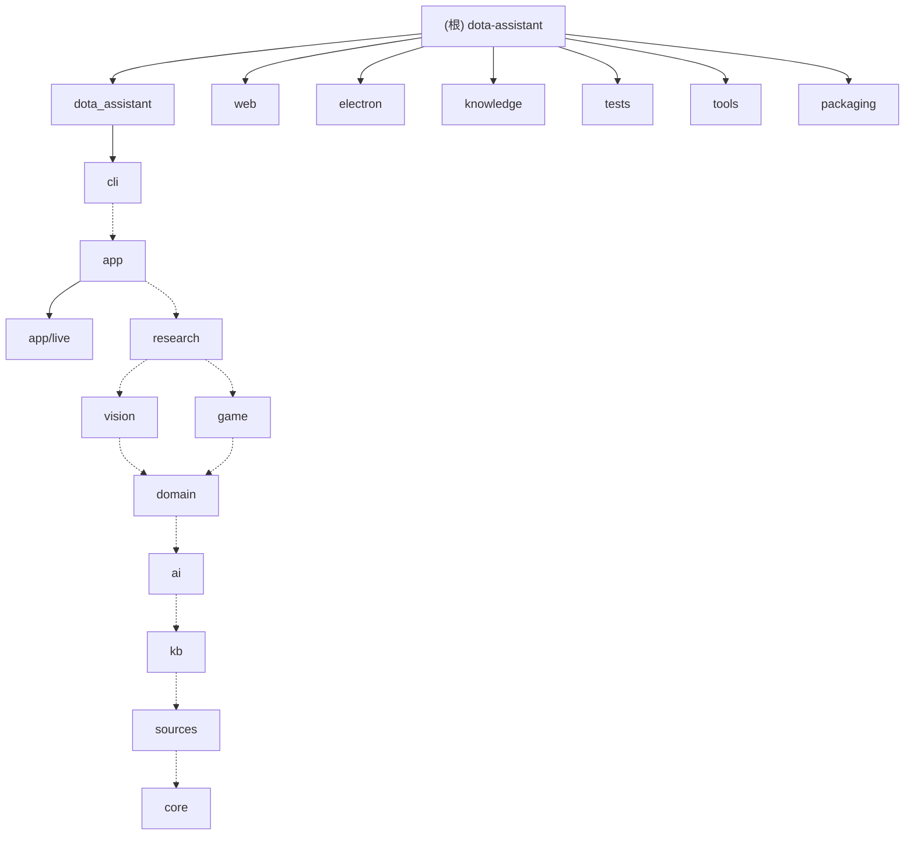

# 项目指令

Dota 2 选人助手（自用）。**接手先读 [docs/HANDOFF.md](docs/HANDOFF.md)**：需求、当前状态、下一步（一两屏）；各功能的设计 / 验证细节在各模块目录的 `NOTES.md`。

**项目愿景**：实时帮玩家打天梯——截图认出选人阵容，按克制 / 配合 / 位置强度推荐英雄；进游戏后靠 Valve GSI 给出装、本局要点、计时和死亡复盘等提醒。只做建议，不碰游戏进程。

## 规则

### 交流与 Git
- 用简体中文交流和写文档、注释。
- 不要在用户没明确要求时 `git commit` / `git push`。用户让提交时，**只要求编译通过**就 commit + push：`python -X utf8 -m compileall -q dota_assistant tests packaging`，改了 JS 再 `node --check`；编译失败就停下报告。

### 改完要实测、跑门禁
- **改完要实测**（这是做改动的一部分，不是提交的门槛，玩家 2026-10-28 定的）：跑 `python -m unittest`，实际用一遍改动涉及的功能（`suggest` 冒烟；改了 .bat 用 cmd 真跑；改了能点的界面起 Electron 用真鼠标点一遍）。实测在改完时做、把结果报给玩家；提交时不再重跑一轮。没测到的在报告里说清楚。
- 改完跑 `python -m unittest`；动了推荐逻辑，再用 `python -m dota_assistant suggest ...` 看几组结果是否符合常识。
- 其余门禁（2026-10-28 工程化重构加的，改完一起跑）：编译也带上 `tools`（`python -X utf8 -m compileall -q dota_assistant tests packaging tools`）；`ruff check dota_assistant tests tools packaging`（没装先 `pip install ruff`；只查未使用 import / 未定义名字 / 语法类，**不要跑 `ruff format`、不要大面积 `--fix`**）；`python tools/golden/run.py check`（行为快照逐字节比对，约 25 秒；行为本来就该变时先看 diff 确认差异都是该有的，再 `update-snapshot`，用法见 `tools/golden/README.md`）；`python tools/check_isolation.py`（单测不碰 `data/` `shots/` `logs/` 等真实目录）。`tests/test_smoke.py`、`test_moves.py`、`test_layers.py`、`test_patch_targets.py` 含在 unittest 里。

### 安全与隐私
- 安全底线：只读屏幕截图 + Valve 官方 GSI；不读游戏内存、不注入、不模拟键鼠、不显示玩家本来看不到的信息。
- `config.toml` 里有个人 STRATZ token，不进 git、不要贴到任何外部服务。

### Dota 机制问题先查知识库
- **回答 Dota 机制问题（技能 / 物品能做什么、克不克制）先查知识库**：`python -m dota_assistant kb hero|item|find ...`，引用官方原句，查不到就说查不到，不凭记忆；文档里的机制结论也要回原文核对。`kb hero/item` 输出末尾的「常见误判」先看。玩家纠正的判断写进 `knowledge/rules.toml`；机制事实说错了（打法页 AI 或你自己），用 `python -m dota_assistant kb mistake --wrong … --right … --hero … --who …` 记进 `knowledge/mistakes.toml`。

### Windows 编码规范
- Windows 基础规范（`tests/test_hygiene.py` 会查）：文本文件一律 UTF-8 无 BOM；`.bat` / `.cmd` 必须 CRLF（`.gitattributes` 已配）；Python 里 `open` / `read_text` / `write_text` / `subprocess(text=True)` 都要显式写 `encoding="utf-8"`；子进程输出按 UTF-8 解码前先确认对方真输出 UTF-8。

### 代码分层
- 代码按层分在 `dota_assistant/` 的子包里：`core` → `sources` → `kb` → `ai` → `domain` → `vision` / `game` → `research` → `app`（实时主控在 `app/live/`）→ `cli`，只能 import 同层或更低层（`tests/test_layers.py` 查），每个文件管什么见各模块的 `CLAUDE.md`（下面的模块索引）。不留转发旧路径的空壳模块；跨模块共享的函数用 `模块.函数` 形式调用（例如 `http._get(...)`），测试 patch 定义它的那个模块（`tests/test_patch_targets.py` 查）。

### 文档同步
- 做完的功能 / 修完的问题 / 验证结论：在主要涉及的模块目录的 `NOTES.md` 末尾追加一节（节号全局接着编，加进 HANDOFF 末尾的「节号索引」）；`docs/HANDOFF.md` 只改「当前状态」那一行和「下一步」，**不往 HANDOFF 里堆过程记录**（2026-11-04 玩家嫌 HANDOFF 太长，拆过一次）。
- 各模块目录下有 `CLAUDE.md`（职责、文件表、接口、坑、对应测试），改了文件职责顺手更新对应那份。

## 架构总览

- **离线数据**：`app/update.py` 按顺序拉一遍——经 `sources/` 拉 OpenDota（克制 / 配合、定位标签）、STRATZ（分位置胜率、个人对局）、Valve datafeed / CDN（中文名、头像、图标），经 `kb/` 拉 Valve datafeed（知识库原文），都缓存到 `data/`（不进 git）。
- **实时主控**：`app/live/` 的 `Live` 一个工作线程按顺序处理定时识别、网页操作、热键；`vision/` 截图认选人格子 → 控制面板 10 个格子（**唯一的「当前局面」**，识别和手动输入都只往里写）→ `domain.advisor.Advisor` → `domain.engine.Engine` 打分。
- **界面**：`app/webui.py` 起 127.0.0.1 本地服务（静态页 + SSE 快照 + POST 操作），`electron/` 只开窗口加载 `web/` 页面（叠加层 / 顶栏计时 / 控制面板 / 队友战绩）。
- **局内**：`game/gsi.py` 收 Valve GSI 推送 → `domain/` 的出装、缺口提醒、本局要点、野区、买活、大招冷却、死亡复盘；AI 打法走 `ai/`。

## 模块结构图

实线 = 目录包含；虚线 = 分层方向（高层 → 低层，只能沿箭头方向 import；vision 与 game 平级）。

## 模块索引

| 模块 | 一句话职责 |
|---|---|
| [core](dota_assistant/core/CLAUDE.md) | 最底层：配置 `Config` / 运行目录 `ROOT`、日志、英雄表、找 Dota 目录、GSI 字段常量、VPK 读取 |
| [sources](dota_assistant/sources/CLAUDE.md) | 联网拉数据并缓存到 `data/`：OpenDota / STRATZ / Valve，克制、分位置、个人数据、头像图标 |
| [kb](dota_assistant/kb/CLAUDE.md) | 当前版本知识库：Valve 官方技能 / 物品原文、机制标签、玩家规则、常见误判；大招冷却条目 |
| [ai](dota_assistant/ai/CLAUDE.md) | 调大模型（Claude Code / Anthropic / OpenAI 兼容）；AI 打法页（每条带原文出处、程序核对） |
| [domain](dota_assistant/domain/CLAUDE.md) | 领域逻辑：打分引擎、推荐、分路、出装、缺口提醒、本局要点、死亡复盘、野区、买活、大招、队友战绩 |
| [vision](dota_assistant/vision/CLAUDE.md) | 看屏幕：截图、顶栏头像识别、网格认禁用、OCR 认位置、买活自动记、校准窗口 |
| [game](dota_assistant/game/CLAUDE.md) | 和游戏 / 系统打交道：GSI 本地服务 + cfg 安装、全局热键、语音 |
| [research](dota_assistant/research/CLAUDE.md) | 回测与研究：样本外回测、AI 选人盲测、对线优劣回测 / 实战复盘 |
| [app](dota_assistant/app/CLAUDE.md) | 编排：本地网页服务、一键启动、演示、数据更新、助手自更新 |
| [app/live](dota_assistant/app/live/CLAUDE.md) | 实时主控 `Live`：类本体 + 七个 mixin（选人 / 局内 / 计时 / 卡片 / 叠加层 / 设置 / 游戏画面野点）+ consts |
| [cli](dota_assistant/cli/CLAUDE.md) | 最上层：`python -m dota_assistant <命令>` 全部命令入口 |
| [web](web/CLAUDE.md) | 原生 HTML/CSS/JS 页面：叠加层、顶栏计时、控制面板、队友战绩 |
| [electron](electron/CLAUDE.md) | 界面外壳：只开透明 / 置顶 / 穿透窗口，无业务逻辑 |
| [knowledge](knowledge/CLAUDE.md) | 进 git 的玩家规则 `rules.toml` 和 AI 常见误判 `mistakes.toml` |
| [tests](tests/CLAUDE.md) | `python -m unittest`：功能测试 + 守门测试（分层、patch、搬家、冒烟、编码） |
| [tools](tools/CLAUDE.md) | 门禁工具：行为快照 golden、隔离检查、无头浏览器检查、锁依赖、重构核对脚本 |
| [packaging](packaging/CLAUDE.md) | 免安装打包（PyInstaller + Electron）和打包版 exe 入口 |

## 运行

- 玩家日常：双击 `启动助手.bat`（= `python -m dota_assistant start`）。开发常用：`update [--player]`、`suggest`、`run [--browser]`、`demo`、`kb ...`，完整命令表见 [cli](dota_assistant/cli/CLAUDE.md) 和 [cli/NOTES.md](dota_assistant/cli/NOTES.md)（常用命令）。
- 运行时生成、和机器相关：`calibration.json`（校准）、`templates/`（学到的识别模板，值得保留）、`shots/`、`data/`、`logs/`；其中 `config.toml`、`data/`、`shots/`、`logs/`、`templates/` 在 `.gitignore` 里。

## 变更记录 (Changelog)

- 2026-11-04：HANDOFF 从 2647 行拆到约 200 行，过程记录按模块搬进各目录的 `NOTES.md`（`domain` 分选人 / 局内两份，重构相关进 `docs/refactor/NOTES.md`）；改「文档同步」规则。
- 2026-11-02 11:18:41：按「根级简明 + 模块级详尽」重排本文件：原 15 行规则原文保留、分小节；加项目愿景、架构总览、Mermaid 结构图、模块索引；新建 17 份模块级 CLAUDE.md。
